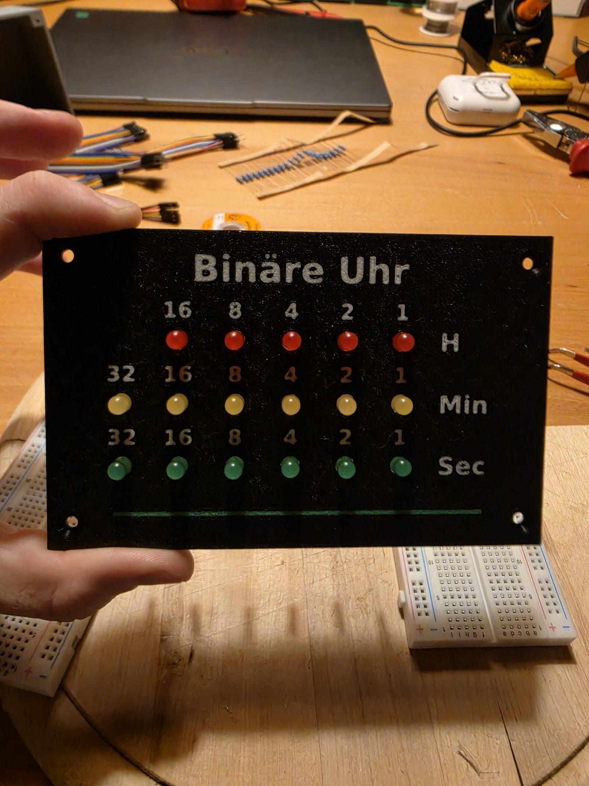
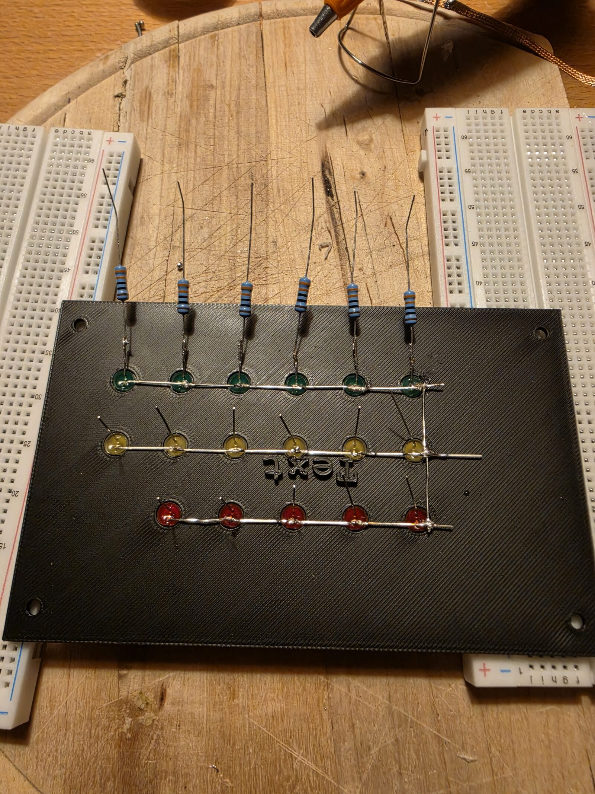
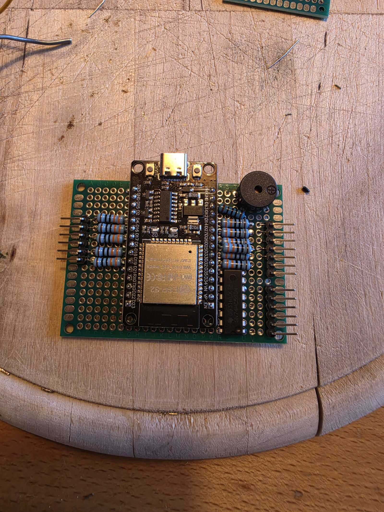
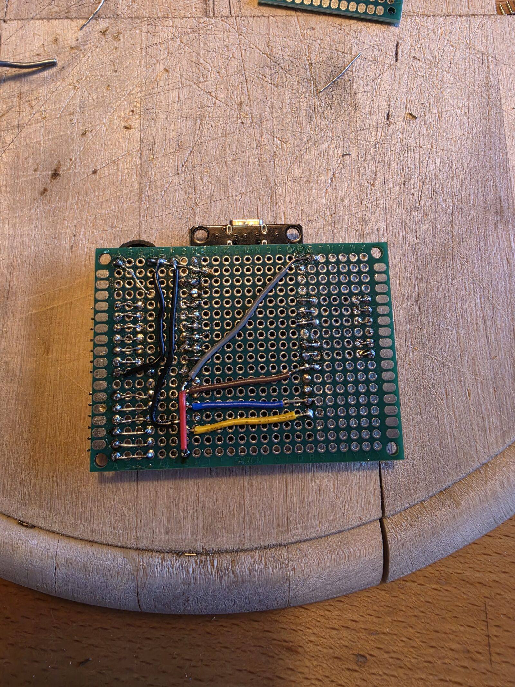

# Binary Clock

A self-built binary clock based on an ESP32, programmed in MicroPython.
Hours, minutes and seconds are shown in true binary (no BCD) on 17 LEDs.
The time is fetched from the internet (NTP) and converted to Austrian local
time, including automatic daylight saving time. A passive buzzer chimes on the
full hour, except during quiet hours at night.

This is also a learning project: I wrote the program myself while learning
Python and MicroPython. The hardware is soldered and 3D printed by me.



*Front panel (3D printed) with the 17 LEDs: red = hours, yellow = minutes,
green = seconds. The labels show the value of each LED, the highest on the left.*

## Status

Work in progress. The software grows milestone by milestone.

| # | Milestone | State |
|---|---|---|
| 1 | Blink an LED, rolling light over all direct LEDs | done |
| 2 | Show a number in binary on several pins (`>>`, `&`) | done |
| 3 | Drive the 74HC595 shift register by hand, mirrored seconds | done |
| 4 | Clock counter without internet | done |
| 5 | WLAN and NTP | WLAN written, NTP open |
| 6 | Time zone and daylight saving time (CET/CEST) | open |
| 7 | Buzzer: hourly chime, quiet hours | open |
| 8 | Cleanup, error handling (what if the WLAN is gone?) | open |
| 9 | Optional: night mode, binary beeps, auto start | open |

The code is tested with a simulated register on the PC. The WLAN part is not
yet tested on the real hardware.

## Features

- Rolling light over all LEDs at startup as a wiring test
- Binary display: hours (5 LEDs), minutes (6 LEDs), seconds (6 LEDs)
- Own shift register driver for the 74HC595, without a library
- Planned: NTP time sync, CET/CEST, hourly chime, quiet hours

## Hardware

| Part | Amount | Note |
|---|---|---|
| ESP32 DevKit (WROOM, 30 pins, CH340 USB) | 1 | |
| LED, red | 5 | hours (values 1, 2, 4, 8, 16) |
| LED, yellow | 6 | minutes (values 1, 2, 4, 8, 16, 32) |
| LED, green | 6 | seconds (values 1, 2, 4, 8, 16, 32) |
| SN74HC595N shift register | 1 | drives the seconds LEDs |
| Passive buzzer | 1 | needs a PWM square wave |

### Pin assignment

| Function | Connection |
|---|---|
| Hours, value 1 / 2 / 4 / 8 / 16 | GPIO 4 / 16 / 17 / 18 / 19 |
| Minutes, value 1 / 2 / 4 / 8 / 16 / 32 | GPIO 14 / 27 / 26 / 25 / 33 / 32 |
| Seconds, value 1 / 2 / 4 / 8 / 16 / 32 | 74HC595 Q6 / Q5 / Q4 / Q3 / Q2 / Q1 |
| 74HC595 SER (data) | GPIO 23 |
| 74HC595 SRCLK (shift clock) | GPIO 21 |
| 74HC595 RCLK (latch) | GPIO 22 |
| 74HC595 OE | fixed to GND (outputs always on) |
| 74HC595 SRCLR | fixed to 3.3 V |
| 74HC595 Q0, Q7 | unused |
| Buzzer | GPIO 13 |

## Build

### Front panel

The front panel is 3D printed. Each LED sits in its own hole, the resistors
are soldered to the LED legs on the back, and the anodes or cathodes of each
row are tied together with a bare wire.



*Back of the front panel while soldering: green, yellow and red LED rows with
their resistors.*

### Mainboard

The ESP32, the 74HC595, the resistors for the directly driven LEDs and the
buzzer are on a perfboard. Pin headers connect the LED rows.

| Component side | Solder side |
|---|---|
|  |  |

<!-- Still to add: photo of the assembled clock inside the case,
     photo of the finished clock running. Put them into docs/images/. -->

All photos live in [`docs/images/`](docs/images/).

## How the display works

### Hours and minutes

Every LED sits on its own GPIO pin. A number is split into its bits with a
shift and a mask: bit `n` of `x` is `(x >> n) & 1`. The pin lists are ordered by
value, so index 0 is the LED with value 1, index 1 the LED with value 2, and so
on. One loop writes every bit to the pin with the same index.

### Seconds and the 74HC595

The seconds LEDs hang on a shift register. The program shifts one byte into
the register bit by bit (SER and SRCLK), then pulses RCLK once, so all outputs
change at the same time and no half-shifted pattern is visible.

The wiring is intentionally not "straight":

- the seconds use outputs **Q1 to Q6**, not Q0 to Q5 (shifted by one)
- the order is reversed: value 1 is on **Q6**, value 32 on **Q1** (mirrored)

The code compensates for this in software: second bit `j` goes to byte bit
`6 - j`. Examples:

| Second | Byte (Q7 ... Q0) |
|---|---|
| 1 | `01000000` |
| 3 | `01100000` |
| 5 | `01010000` |
| 32 | `00000010` |

## Software setup

1. **Flash MicroPython** onto the ESP32. Download the firmware for the
   generic ESP32 from <https://micropython.org/download/ESP32_GENERIC/> and
   follow the instructions there (erase the flash, then write the firmware).
2. **Create `secrets.py`** on your computer next to `main.py`. It contains
   exactly two variables, your WLAN name and password:

   ```python
   ssid = "your-network-name"
   pw = "your-password"
   ```

   This file is listed in `.gitignore` and must never be committed. Note that
   the ESP32 only supports 2.4 GHz WLAN.
3. **Copy the files to the board**, `main.py` and `secrets.py`, for example
   with Thonny or `mpremote`.
4. **Start** the program (or reset the board). The rolling light runs first,
   then the WLAN connection is established, then the clock starts.

## Project structure

```
binary_clock/
├── main.py          the program
├── secrets.py       WLAN credentials (not in git)
├── .gitignore
├── README.md
└── docs/
    └── images/      photos for this README
```

## Source

The Python basics come from the book "Python Der Grundkurs" (Rheinwerk), in
German.

## License

Not chosen yet.
